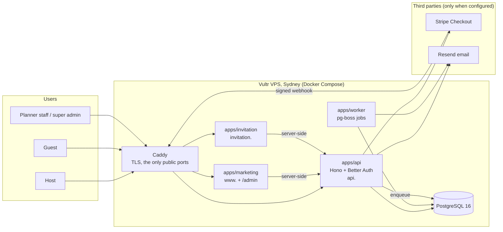
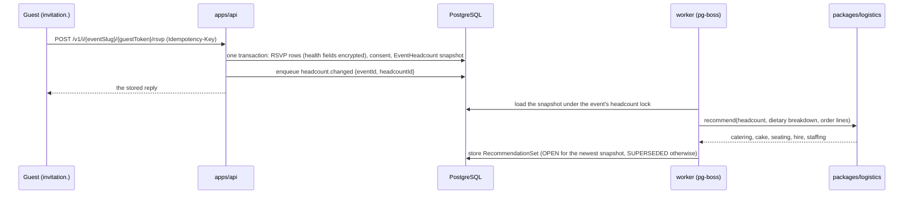

# Managevent architecture

How the system is put together today, and the target shape it is growing into. Every section separates what is **built** from what is **planned**; planned work points to its [`ROADMAP.md`](ROADMAP.md) id. Decisions are recorded as ADRs in [`docs/architecture/adr/`](docs/architecture/adr/) (§15); unresolved ones are in [`docs/architecture/OPEN_DECISIONS.md`](docs/architecture/OPEN_DECISIONS.md). How production runs is in [`DEPLOYMENT.md`](DEPLOYMENT.md); routes and page rules are in [`WEBSITE.md`](WEBSITE.md).

## 1. Principles

1. **One platform, three business lines.** The agency, the marketplace and the invitation tools share one database, one API and one identity system. Apps are separate deployables; none of them owns business data. The API does.
2. **The RSVP → logistics bridge is the product.** Guest replies on `invitation.` produce headcount snapshots, and those drive catering, cake, seating and hire recommendations (§6).
3. **Contracts first.** `packages/validators` (Zod) and `packages/db` (Prisma) are the contracts that apps are built against in parallel.
4. **Australian data residency.** Personal information is stored in Sydney. Any exception needs an ADR (ADR-0008).
5. **Offline where the venue is.** The planned crew app and Windows kiosk must keep working without Wi-Fi (§11).
6. **English (en-AU) first, language-ready.** Logical CSS and a typed `Locale` mean another language can be added through `packages/i18n` without rewriting pages.
7. **Memorial Mode is an experience mode,** derived by `getExperienceMode()`, not a theme toggle.

## 2. System context

**Planned additions:** the customer portal `app.` (PRT), the vendor portal `vendors.` (VEN), the Expo app (MOB) and the Windows app (WIN), all calling the same API; Twilio for SMS and WhatsApp (INV-08); Cloudflare R2 for media (INV-11); Gemini through `packages/ai` (INV-04); a realtime provider (D-03); Xero and ABN Lookup through `packages/integrations` (ADM-06, VEN-01).

## 3. Deployables

| App                | Runtime                                  | Status and host                                                                                                                             |
| ------------------ | ---------------------------------------- | ------------------------------------------------------------------------------------------------------------------------------------------- |
| `apps/marketing`   | Next.js 16 App Router, prerendered pages | Built. Container on the VPS, port 3100. Also serves the staff console at `/admin`                                                           |
| `apps/invitation`  | Next.js 16 App Router, server-rendered   | Built. Container on the VPS, port 3001                                                                                                      |
| `apps/api`         | Hono on Node 22, run through `tsx`       | Built. Container on the VPS, port 4000. 53 OpenAPI operations plus a CSV export, the Stripe webhook, two CLIs (`seed:demo`, `staff:create`) |
| `apps/worker`      | Node 22, pg-boss                         | Built. Container on the VPS, no port                                                                                                        |
| `apps/admin`       | Library (no UI)                          | Staff-role helpers. The console UI lives in `apps/marketing`                                                                                |
| `apps/portal`      | Next.js, authenticated                   | Planned (PRT-01). Placeholder `package.json` and `AGENTS.md` only                                                                           |
| `apps/vendors`     | Next.js, authenticated, Stripe Connect   | Planned (VEN-01). Placeholder only                                                                                                          |
| `apps/mobile`      | Expo, EAS                                | Planned (MOB-01). Placeholder only                                                                                                          |
| `apps/desktop-win` | Tauri v2 with local SQLite               | Planned (WIN-01). Placeholder only                                                                                                          |

Production is one Vultr server in Sydney running Docker Compose with Caddy in front ([ADR-0011](docs/architecture/adr/0011-production-on-single-sydney-vps.md)). There is no Vercel, Fly.io or Supabase, no CDN and no staging. Nothing from this branch has been deployed yet (OPS-01).

**The single authorisation layer.** The web apps never import Prisma. Every read and write goes server-side (server components, server actions, route handlers) to `apps/api` through `@managevent/api-client`, which is generated from the API's OpenAPI document. The browser talks to the API only through each web app's same-origin `/api/auth/*` proxy, for sign-in.

## 4. Domains and routing

| Host                           | Target                                | Status                                                   |
| ------------------------------ | ------------------------------------- | -------------------------------------------------------- |
| `www.managevent.com.au`        | `apps/marketing` (including `/admin`) | DNS points at the VPS                                    |
| `invitation.managevent.com.au` | `apps/invitation`                     | DNS points at the VPS                                    |
| `api.managevent.com.au`        | `apps/api`                            | DNS points at the VPS                                    |
| `managevent.com.au`            | Caddy 301 to `www.`                   | Configured in Caddy; DNS still points elsewhere (OPS-07) |
| `app.managevent.com.au`        | `apps/portal`                         | Planned (PRT-01)                                         |
| `vendors.managevent.com.au`    | `apps/vendors`                        | Planned (VEN-01)                                         |
| `media.managevent.com.au`      | R2 public bucket                      | Planned (INV-11)                                         |

There is no `admin.` host: the staff console is `www.managevent.com.au/admin`. The DNS records are in [`infra/DOMAINS_AND_DNS.md`](infra/DOMAINS_AND_DNS.md) and [`DEPLOYMENT.md`](DEPLOYMENT.md#dns).

## 5. Identity, sessions and RBAC

- **Better Auth** (ADR-0005) runs inside `apps/api`, configured in `packages/auth`, with its tables in our database. Sign-in is **email and password** with **30-day sessions**. The `twoFactor` (TOTP) and `bearer` plugins are on; `magicLink` is registered only when an email sender is configured. Google and Apple sign-in are not configured.
- **Staff** (`PLANNER_STAFF`, `SUPER_ADMIN`) must use TOTP: the API treats a staff session without it as signed out. Staff accounts are created only with the API's `staff:create` CLI. An 8-hour staff session is planned (OPS-10).
- **Session cookie:** `managevent.session_token` (with the `__Secure-` prefix in production), HttpOnly, SameSite=Lax. With `AUTH_COOKIE_DOMAIN=.managevent.com.au` it is shared by `www.` and `invitation.`. Each web app proxies `/api/auth/*` on its own origin, so the cookie is set there; the API resolves the session against the database on every request and never trusts identity headers.
- **Guests have no accounts.** A guest is authorised by the invitation link alone, matched exactly against the stored token (`WEBSITE.md` §B6).
- **RBAC:** the roles (`CUSTOMER_HOST`, `GUEST`, `VENDOR`, `PLANNER_STAFF`, `CHECKIN_CREW`, `SUPER_ADMIN`) and the permission matrix with resource scopes (`own`, `self`, `org`, `roster`, `all`) are in `packages/auth/src/permissions.ts`. A host can act only on events they own or co-host; an event they may not read answers 404. Door crew (`roster` scope) reach only the check-in routes.
- **Co-hosts:** `OWNER`, `EDITOR` and `VIEWER` exist in the data model and permissions, and a `VIEWER` never receives guest links. Inviting a co-host is planned (INV-17).

## 6. The RSVP → logistics bridge

Built up to the stored recommendation:

A host recording a reply in the studio takes the same path.

**Planned:** showing recommendations to the host and applying one to re-price an order (PRT-03, PRT-04), flagging out-of-tolerance order lines for staff (ADM-03), and realtime updates (D-03). The worker reads the event's active order lines when there are some, but nothing creates orders yet, so today every set is computed without them.

**Rules** (`packages/logistics/src/engine.ts`, pure functions with tests):

- **Headcount basis:** confirmed adults + confirmed children + a "maybe" allowance (50% by default) + a planner buffer (5% by default, at least 2 guests).
- **Catering:** portions per dietary category, with a **separate count for each allergen** that is never merged into "other".
- **Cake:** a full serve per guest for weddings and milestones, 0.75 for cocktail and solemn events.
- **Seating:** tables by type (`ROUND_10`, `ROUND_8`, `BANQUET_12`), optional kids' tables.
- **Hire:** chairs, linen and tableware with a breakage buffer (5% by default).
- **Staffing:** waiters by service style (plated, banquet, buffet, cocktail), plus RSA-certified staff when alcohol is served ([`docs/compliance/LIQUOR_FOOD_SAFETY_WA.md`](docs/compliance/LIQUOR_FOOD_SAFETY_WA.md)).
- **Cut-offs:** after an order line's `finalNumbersDueAt`, recommendations are advisory only.

## 7. API modules

Built (`apps/api/src/modules`; routes in [`apps/api/README.md`](apps/api/README.md)):

| Module          | Responsibilities                                                                           |
| --------------- | ------------------------------------------------------------------------------------------ |
| `identity`      | `GET /v1/me`: the signed-in user and the deployment's capabilities                         |
| `events`        | Events, the invitation design and content, publish and unpublish                           |
| `billing`       | Invitation plan, Stripe Checkout for the Premium Event Pass, the signed Stripe webhook     |
| `guest-list`    | Households (parties) and guests, CSV import and export, link revoke and reissue            |
| `guest-site`    | The guest view, RSVP, passes, calendar, wishes, sample invitations, legacy link resolve    |
| `responses`     | Totals and the dietary breakdown                                                           |
| `headcount`     | Headcount snapshots and the `headcount.changed` job                                        |
| `checkin`       | Door list and scans                                                                        |
| `well`          | Wishing well and tribute book moderation                                                   |
| `messaging`     | Email invitations, RSVP reminders, unsubscribe                                             |
| `crm`           | Leads from the enquiry form; the staff inbox                                               |
| `site-settings` | Public contact email/phone for www; staff admin settings and new-enquiry alert destination |

Planned: `catalog` and `orders` (packages, quotes, order lines, applying recommendations: MKT-05, PRT-04, PRT-05), `payments` beyond the invitation pass (deposits, milestones, tax invoices: PRT-06), `marketplace` (VEN, MKP), `inventory` (ADM-05), `ai` (INV-04), `reporting` (ADM-06), Twilio and Resend webhooks (INV-08), and an estimate `builder` (not scheduled).

## 8. Data

- **PostgreSQL 16** through Prisma 6. The schema is `packages/db/prisma/schema.prisma`, specified in [`packages/db/DATA_MODEL.md`](packages/db/DATA_MODEL.md). Migrations are append-only (latest: `20261112000000_invitation_platform`).
- **IDs:** prefixed UUIDv7 strings (`evt_…`, `pty_…`, `gst_…`), ADR-0006.
- **Money:** integer AUD cents. GST is calculated only in `packages/payments`.
- **Time:** instants in UTC; events carry an IANA time zone, `Australia/Perth` by default.
- **Soft delete:** `deletedAt` on customer-facing records. The retention job that clears dietary and allergy data 90 days after an event is declared in `apps/worker/src/schedules.ts` but has no handler (PRV-01).
- **Audit:** an append-only `AuditLog` records money changes and other sensitive writes.
- **Encryption:** dietary, allergy and accessibility details are encrypted at field level with AES-256-GCM (`enc:v1:` prefix, key `PII_ENCRYPTION_KEY`, `packages/db/src/encryption.ts`).
- **Webhooks:** each Stripe event is stored once in `WebhookEvent` and applied once.
- **Local development** runs PostgreSQL without Docker through `embedded-postgres` (`pnpm db:local:detach`, ADR-0012).

## 9. Files and media (planned, INV-11)

Today there are no uploads: hosts paste HTTPS links for cover, gallery and music. The plan: Cloudflare R2 with a public bucket (published invitation assets) and a private one (guest uploads before moderation, vendor documents), private objects served only through short-lived signed URLs (`packages/storage`, not used by any app yet), and image processing in the worker. R2 has no Australian jurisdiction guarantee, so media residency is OPEN_DECISIONS D-04.

## 10. Messaging

- **Email (Resend), built:** enquiry auto-reply and planner alert (`lead.created`), invitation emails and RSVP reminders (`invitation.email_campaign`, swept every five minutes by `invitation.email_campaign_sweep`), magic links and password reset. The API and worker call Resend's HTTP API directly. Without `RESEND_API_KEY` nothing is sent and nothing is reported as sent. Reminders respect quiet hours (8 am to 8 pm in the event's time zone) and every invitation email has a signed unsubscribe link. Separate senders: `EMAIL_FROM_TRANSACTIONAL` and `EMAIL_FROM_INVITATIONS`. Live Resend has never been exercised (OPS-02).
- **SMS and WhatsApp (Twilio), planned (INV-08):** consent, quiet hours, suppression, approved WhatsApp templates and a signed delivery webhook. `packages/notifications` has wrappers that no app uses yet. Spam Act rules: [`docs/compliance/MESSAGING_SPAM_ACT.md`](docs/compliance/MESSAGING_SPAM_ACT.md).
- **Push (Expo), planned (MOB-06).**

## 11. Offline-first clients (planned)

| Client                    | Local store             | Sync                                                                                                                                                                                          |
| ------------------------- | ----------------------- | --------------------------------------------------------------------------------------------------------------------------------------------------------------------------------------------- |
| Mobile crew mode (MOB-03) | SQLite (`expo-sqlite`)  | Pulls an event pack (guests, passes, tables, dietary flags) before the event. Scans queue locally with a client UUID and are pushed when online; the server dedupes per pass, first scan wins |
| Windows kiosk (WIN-05)    | SQLite on the Rust side | The same event pack                                                                                                                                                                           |
| Windows display (WIN-06)  | Local media cache       | Pre-downloads the slideshow, tribute reel and approved photo-wall items                                                                                                                       |

Event packs will be signed by the API and expire 48 hours after the event; health data in a pack is limited to dietary and allergy flags and is encrypted on disk. What exists today: signed QR passes (`MV1.{passId}.{signature}`) and the check-in API with a `clientUuid` per scan, used by the web door page on `invitation.`.

## 12. AI (planned, INV-04)

`packages/ai` holds a Gemini client, guards and quotas but no app calls it (ADR-0009). When wired: every model call goes through `apps/api`, keys never reach a client, outputs are validated against Zod schemas, prompts are versioned, each user has a quota, a PII scrubber keeps guest names out of prompts, and generated text is always editable and never auto-sent. Memorial content uses a dedicated prompt that never jokes and never invents biographical facts.

## 13. Observability and operations

- **Logs:** the API logs method, redacted path, status and duration, never bodies; guest tokens are redacted. Caddy's access log redacts guest-link paths and query strings and truncates addresses. Redaction helpers are in `packages/config`.
- **Not built:** error tracking and uptime monitoring (OPS-06).
- **Backups:** a nightly `pg_dump`, encrypted with age, kept on the server; copying it off the server needs a bucket in Australia (OPS-05, D-18). There is no point-in-time recovery. Details in [`DEPLOYMENT.md`](DEPLOYMENT.md#backups-and-restore).
- **Rate limits** are in API process memory (OPS-11).

## 14. Environments

`local` (no Docker needed; marketing 3100, invitation 3001, API 4000, PostgreSQL 5432) → CI (GitHub Actions with a PostgreSQL service) → `production` (the Sydney VPS). There is no staging and no per-PR preview (D-19, OPS-08). Variables are listed in [`infra/ENVIRONMENTS.md`](infra/ENVIRONMENTS.md); local set-up is [`infra/LOCAL_DEV.md`](infra/LOCAL_DEV.md).

## 15. Architecture Decision Records

ADRs are append-only. Each carries a Status line saying whether parts of it were superseded.

| ADR                                                                   | Decision                                                                      |
| --------------------------------------------------------------------- | ----------------------------------------------------------------------------- |
| [0001](docs/architecture/adr/0001-monorepo-turborepo-pnpm.md)         | Turborepo + pnpm monorepo                                                     |
| [0002](docs/architecture/adr/0002-web-nextjs-app-router.md)           | Next.js App Router, one app per subdomain (hosting clause superseded by 0011) |
| [0003](docs/architecture/adr/0003-api-hono-separate-service.md)       | Separate Hono API and pg-boss worker (hosting clause superseded by 0011)      |
| [0004](docs/architecture/adr/0004-postgres-prisma-sydney.md)          | PostgreSQL + Prisma in Sydney (provider clause superseded by 0011)            |
| [0005](docs/architecture/adr/0005-auth-better-auth.md)                | Better Auth, self-hosted (amended: email and password, TOTP for staff)        |
| [0006](docs/architecture/adr/0006-ids-money-time.md)                  | IDs, money in cents, time zones (`Australia/Perth` default)                   |
| [0007](docs/architecture/adr/0007-mobile-expo-desktop-tauri.md)       | Expo for mobile, Tauri v2 for Windows                                         |
| [0008](docs/architecture/adr/0008-data-residency.md)                  | Data residency rules for third parties                                        |
| [0009](docs/architecture/adr/0009-ai-gemini-via-package.md)           | Gemini behind `packages/ai` only                                              |
| [0010](docs/architecture/adr/0010-typescript-version.md)              | TypeScript 5.9 pinned                                                         |
| [0011](docs/architecture/adr/0011-production-on-single-sydney-vps.md) | Production on one Sydney VPS with Docker Compose and Caddy                    |
| [0012](docs/architecture/adr/0012-embedded-postgres-dev-exception.md) | `embedded-postgres` allowed for local development only                        |
