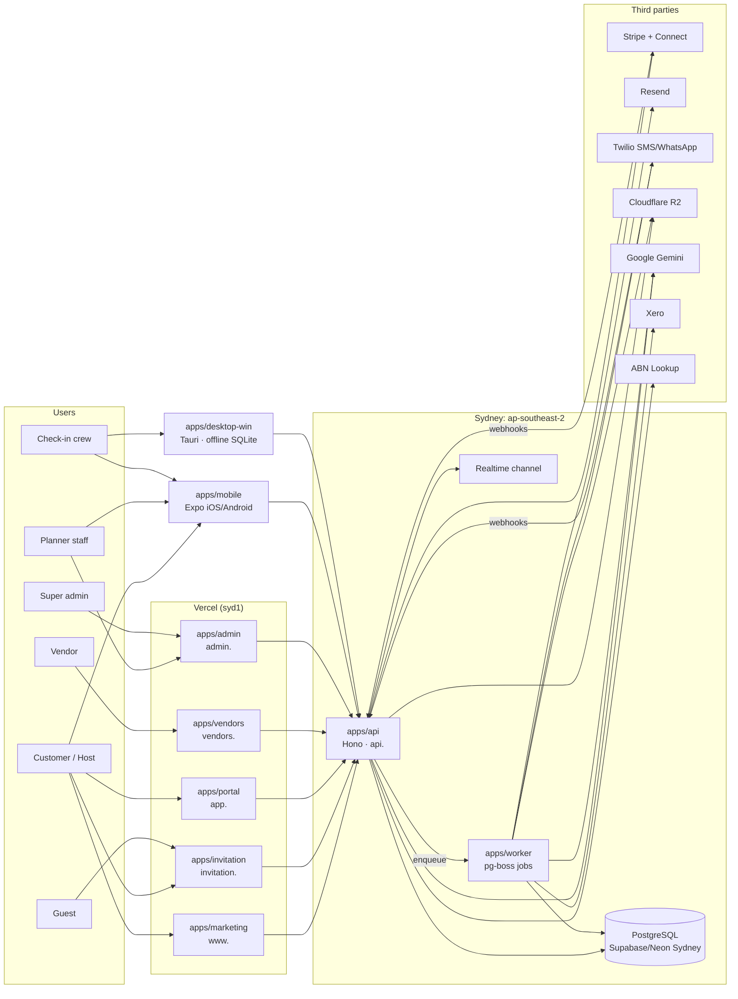
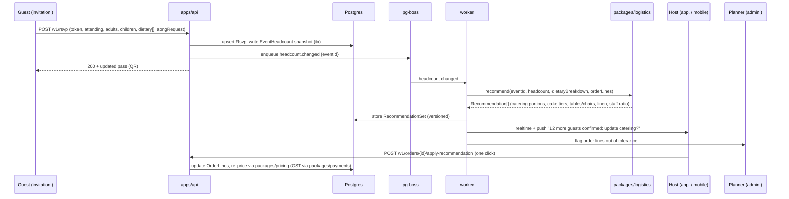

# Managevent architecture

Status: **v0.1, the baseline specification.** Decisions are recorded as ADRs in `docs/architecture/adr/`. Unresolved items are in `docs/architecture/OPEN_DECISIONS.md`.

## 1. Principles

1. **One platform, three business lines.** The agency, the marketplace and the invitation tools share one database, one API and one identity system. The apps are separate deployables, but none of them owns business data. The API does.
2. **The RSVP → logistics bridge is the product.** Guest responses on `invitation.` update headcounts, and those headcounts drive the catering, cake, seating and hire recommendations on `app.`, `admin.` and `vendors.` (§6).
3. **Contracts first.** `packages/validators` (Zod) and `packages/db` (Prisma) are the contracts. Each app is built by a different agent against those contracts, in parallel.
4. **Australian data residency.** All PII lives in Sydney (`ap-southeast-2`). Any exception needs an ADR.
5. **Offline where the venue is.** The crew mobile app and the Windows kiosk keep working without Wi-Fi and sync later.
6. **Bilingual and RTL from day one.** EN and FA are fully supported. AR, ZH and HI can be switched on through configuration.
7. **Memorial Mode is a first-class experience mode,** not a theme toggle.

## 2. System context

## 3. Deployables

| App                | Runtime                                    | Host                                                    | Notes                                                                                          |
| ------------------ | ------------------------------------------ | ------------------------------------------------------- | ---------------------------------------------------------------------------------------------- |
| `apps/marketing`   | Next.js (App Router), mostly static or ISR | Vercel, functions in `syd1`                             | SEO-critical. The CMS content comes from `content/` first and a headless CMS later (see D-06). |
| `apps/invitation`  | Next.js, SSR and ISR per event             | Vercel `syd1`                                           | Guest pages are cacheable per token, and RSVP posts go to the API.                             |
| `apps/portal`      | Next.js, authenticated                     | Vercel `syd1`                                           | Customer dashboard.                                                                            |
| `apps/vendors`     | Next.js, authenticated                     | Vercel `syd1`                                           | Vendor dashboard and Stripe Connect onboarding.                                                |
| `apps/admin`       | Next.js, authenticated with MFA required   | Vercel `syd1`                                           | Staff only. IP allow-list optional.                                                            |
| `apps/api`         | Hono on Node 22                            | Container in Sydney (Fly.io `syd` by default, see D-01) | REST plus webhooks, with OpenAPI generated from Zod.                                           |
| `apps/worker`      | Node 22 with a pg-boss queue               | The same container platform                             | Reminders, payouts, AI jobs, media transcoding, Xero sync.                                     |
| `apps/mobile`      | Expo with EAS Build and OTA updates        | App Store and Google Play                               | Role-based: customer mode and crew mode.                                                       |
| `apps/desktop-win` | Tauri v2 (Rust core, React UI)             | MSI or MSIX, auto-updater                               | Back-office and offline kiosk, with local SQLite.                                              |

The web apps call `apps/api` for all writes. Next.js server components **may read** from the API through `packages/api-client` using server-side credentials. They must **never** import Prisma directly. This keeps a single authorisation layer.

## 4. Domains and routing

| Host                           | Target                          |
| ------------------------------ | ------------------------------- |
| `managevent.com.au`            | 301 to `www.`                   |
| `www.managevent.com.au`        | `apps/marketing`                |
| `invitation.managevent.com.au` | `apps/invitation`               |
| `app.managevent.com.au`        | `apps/portal`                   |
| `vendors.managevent.com.au`    | `apps/vendors`                  |
| `admin.managevent.com.au`      | `apps/admin`                    |
| `api.managevent.com.au`        | `apps/api`                      |
| `media.managevent.com.au`      | R2 public bucket via Cloudflare |

The DNS record plan is in `infra/DOMAINS_AND_DNS.md`.

## 5. Identity, sessions and RBAC

- **Better Auth** (ADR-0005) runs inside `apps/api`, with its tables in our own Sydney database. Users can sign in with an email magic link, a password, Google or Apple. MFA (TOTP) is mandatory for `PLANNER_STAFF` and `SUPER_ADMIN`.
- **Session cookie:** set on `.managevent.com.au` (HttpOnly, Secure, SameSite=Lax), giving single sign-on across `www`, `app`, `vendors`, `admin` and `invitation`. Mobile and desktop use bearer tokens stored in secure storage: Keychain or Keystore on mobile, Windows Credential Manager on desktop.
- **Guests do not need accounts.** A guest is authorised by an **invitation token** in the URL (`WEBSITE.md` §B6). Optionally, they can "claim" the RSVP into an account later.
- **RBAC:** roles are defined in `packages/auth`, together with **resource scoping**. A `CUSTOMER_HOST` can access only events where they are owner or co-host. A `VENDOR` can access only bookings assigned to its organisation. A `CHECKIN_CREW` member can access only events on their roster, and only on the event day ± 1.
- **Co-host permissions:** `owner`, `editor` (manage guests and content) or `viewer`.

## 6. The RSVP → logistics bridge

Rules (owned by `packages/logistics`, which has pure functions and full test coverage):

- **Headcount basis:** confirmed adults + confirmed children + a "maybe" allowance (configurable, 50% by default) + planner buffer (default 5%, min 2 guests).
- **Catering:** portions per dietary category (Halal, vegetarian, vegan, gluten-free, allergy-flagged), with a **separate count for each allergen** that is never merged into "other".
- **Cake:** serves are estimated per guest by event type. For example, a wedding is 1 coffee-cut serve per guest. Tiers come from the vendor's or our cake catalogue.
- **Seating:** the number of tables depends on table type (round 10 or 8, banquet), with kids' tables optional. The floorplan editor (Windows and admin) consumes this.
- **Hire:** chairs, linen, cutlery and glassware are generated from the seating rules plus a breakage buffer.
- **Staffing:** a waiter ratio depends on service style (plated, banquet, buffet, cocktail). If alcohol is served, RSA-certified staff are required (see `docs/compliance/LIQUOR_FOOD_SAFETY_WA.md`).
- **Cut-offs:** every vendor order line has a `finalNumbersDueAt`. After that point, recommendations are advisory only and route through the planner.

## 7. Domain modules (inside `apps/api`)

| Module        | Responsibilities                                                                                      | Key packages               |
| ------------- | ----------------------------------------------------------------------------------------------------- | -------------------------- |
| `identity`    | Users, organisations, sessions, roles, co-hosts                                                       | `auth`                     |
| `catalog`     | Ceremony types, packages, services, add-ons, vendor services, venues                                  | `pricing`                  |
| `builder`     | Ceremony Builder sessions, estimates, conversion to leads and quotes                                  | `pricing`, `ai`            |
| `crm`         | Leads, enquiries, follow-ups, pipeline                                                                | —                          |
| `events`      | Events, sub-events (for example Aghd and reception), run-sheets, tasks, timeline                      | —                          |
| `invitations` | Invitation designs, guest list, parties, tokens, RSVP, passes, wishing well, photo wall, tribute book | `storage`, `notifications` |
| `orders`      | Quotes, orders, order lines, change requests, recommendations                                         | `logistics`, `pricing`     |
| `payments`    | Payment schedules, deposits, milestones, refunds, Connect transfers, tax invoices                     | `payments`                 |
| `marketplace` | Vendor onboarding, verification, availability, bookings, reviews                                      | `integrations` (ABN)       |
| `inventory`   | Hire stock, barcodes, reservations, dispatch and return, damage                                       | —                          |
| `checkin`     | Crew rosters, scan events, offline sync, table lookup                                                 | —                          |
| `messaging`   | Email, SMS and WhatsApp campaigns, planner chat, consent and unsubscribe                              | `notifications`            |
| `ai`          | Planner, wording generator, budget allocator (proxy to Gemini with logging and limits)                | `ai`                       |
| `reporting`   | Margin, GST and BAS exports, Xero sync, vendor payouts                                                | `integrations`             |

## 8. Data

- **PostgreSQL 16+** in Sydney, accessed through Prisma. The schema specification is `packages/db/DATA_MODEL.md`.
- **IDs:** prefixed CUID2 or UUIDv7 strings (for example `evt_…`, `gst_…`), as recorded in ADR-0006.
- **Money:** `Int` cents plus a `currency` column (`AUD`). GST is stored separately on every line.
- **Soft delete:** a `deletedAt` column on customer-facing records. A scheduled retention job hard-deletes per `docs/compliance/PRIVACY.md`.
- **Audit:** an `AuditLog` table, append-only, records every write to money, roles, vendor verification and personal data.
- **Encryption:** dietary, allergy and health notes, and memorial tribute contents marked private, are encrypted at field level (AES-256-GCM, key in `PII_ENCRYPTION_KEY`, rotation documented).

## 9. Files and media

- **Cloudflare R2** has two buckets: `public` (marketing imagery, published invitation assets) and `private` (guest uploads before moderation, documents, insurance certificates). Private objects are served only through short-lived signed URLs.
- **Location hint: Oceania (OC).** R2 has no Australian _jurisdiction_ guarantee, so guest photos count as cross-border storage under APP 8 and are disclosed in the privacy policy. See OPEN_DECISIONS D-04.
- **Image pipeline:** uploads are processed by the worker into AVIF and WebP variants plus a blurhash. Video goes to H.264 MP4 at ≤1080p for photo walls and tribute reels.

## 10. Messaging

- **Email (Resend):** transactional mail, invitations with an attached `.ics`, and receipts. Use separate sending domains for transactional mail and invitations to protect reputation.
- **SMS and WhatsApp (Twilio):** invitation delivery, RSVP reminders, and day-of updates. Every send records consent, and every marketing message carries an unsubscribe (Spam Act 2003). WhatsApp uses approved templates only.
- **Push (Expo):** host RSVP alerts, crew roster updates and planner chat.

## 11. Offline-first clients

| Client                     | Local store                            | Sync                                                                                                                                                                                                                                              |
| -------------------------- | -------------------------------------- | ------------------------------------------------------------------------------------------------------------------------------------------------------------------------------------------------------------------------------------------------- |
| Mobile crew mode           | SQLite (expo-sqlite)                   | Pulls the event pack (guests, passes, tables, dietary flags) ≥24h before the event. Scans queue locally with a client UUID and are pushed when online. The server dedupes on (`passId`, first scan wins), and duplicate-scan alerts show locally. |
| Windows kiosk              | SQLite (Rust side, via a Tauri plugin) | Same event pack. Several kiosks at one venue can sync peer-to-peer over the LAN as an optional phase-2 feature, falling back to "last online sync".                                                                                               |
| Windows display controller | Local media cache                      | Pre-downloads the slideshow, tribute reel and approved photo-wall items. New photos stream in when online.                                                                                                                                        |

Event packs are signed by the API and expire 48h after the event ends. Health data in packs is limited to dietary and allergy flags per guest and is encrypted on disk.

## 12. AI

- All model calls go through `packages/ai` → `apps/api /v1/ai/*`. API keys never reach a client.
- **Features:**
  - **AI Ceremony Architect:** brief → timeline, checklist and budget split
  - **Bilingual copywriter:** EN/FA invitation wording in different tones, including Persian classical and modern styles and a respectful memorial tone
  - **Smart budget allocator**
  - **Planner assistant** (staff-only, phase 3)
- Outputs are validated against Zod schemas, using structured JSON output. Prompts are versioned. Each user has a daily quota. Generated text is always editable and never auto-sent.
- **Memorial content:** a dedicated system prompt with tone guardrails. It never generates humour, and it never invents biographical facts. Only details supplied by the user are used.

## 13. Observability and operations

- Use structured JSON logs with PII redaction.
- Error tracking (Sentry, or an alternative that meets the ADR-0008 residency requirement) uses scrubbed events with no request bodies.
- Uptime checks run on all hosts. A status page is optional.
- Backups: provider PITR (≥7 days) plus a nightly logical backup to an AU-region bucket, with a restore test every quarter.

## 14. Environments

`local` → `preview` (one per PR, Vercel) → `staging` (`*.staging.managevent.com.au`) → `production`. Stripe and Twilio run in test mode for everything except production. See `infra/ENVIRONMENTS.md`.

## 15. Architecture Decision Records

| ADR                                                             | Decision                                                          |
| --------------------------------------------------------------- | ----------------------------------------------------------------- |
| [0001](docs/architecture/adr/0001-monorepo-turborepo-pnpm.md)   | Turborepo + pnpm monorepo                                         |
| [0002](docs/architecture/adr/0002-web-nextjs-app-router.md)     | Next.js App Router for all web apps (separate apps per subdomain) |
| [0003](docs/architecture/adr/0003-api-hono-separate-service.md) | Separate Hono API + pg-boss worker in Sydney                      |
| [0004](docs/architecture/adr/0004-postgres-prisma-sydney.md)    | PostgreSQL + Prisma, Sydney region                                |
| [0005](docs/architecture/adr/0005-auth-better-auth.md)          | Better Auth, self-hosted, cross-subdomain cookies                 |
| [0006](docs/architecture/adr/0006-ids-money-time.md)            | IDs, money (cents) and time zones (Australia/Perth default)       |
| [0007](docs/architecture/adr/0007-mobile-expo-desktop-tauri.md) | Expo for mobile, Tauri v2 for Windows                             |
| [0008](docs/architecture/adr/0008-data-residency.md)            | Data residency rules for third parties                            |
| [0009](docs/architecture/adr/0009-ai-gemini-via-package.md)     | Gemini behind `packages/ai` only                                  |
| [0010](docs/architecture/adr/0010-typescript-version.md)        | TypeScript 5.9 pinned; TS 7 native compiler deferred              |
